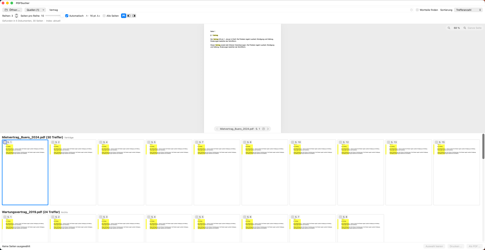

# PDFSucher

macOS-App, die PDF-Ordner durchsucht und Treffer als Seitenkacheln zeigt
(Volltextsuche mit Index, OCR für Scans und Bilder, Auswahl drucken oder als PDF speichern).



## Installation per Homebrew

```bash
brew install --cask g7v5jprvzb-web/tap/pdfsucher
```

Voraussetzung: macOS 26 (Tahoe), Apple Silicon oder Intel.

Die App ist nicht mit einer Apple-Developer-ID signiert und nicht notarisiert. Der Cask entfernt
deshalb nach der Installation das Quarantäne-Attribut. Meldet macOS beim ersten Start trotzdem,
die App könne nicht geprüft werden: Systemeinstellungen > Datenschutz & Sicherheit > „Trotzdem öffnen“,
oder im Terminal:

```bash
xattr -dr com.apple.quarantine /Applications/PDFSucher.app
```

## Selbst bauen

Benötigt Xcode 26 und [XcodeGen](https://github.com/yonaskolb/XcodeGen).

```bash
scripts/build.sh   # Debug-Build
scripts/test.sh    # Tests
```
