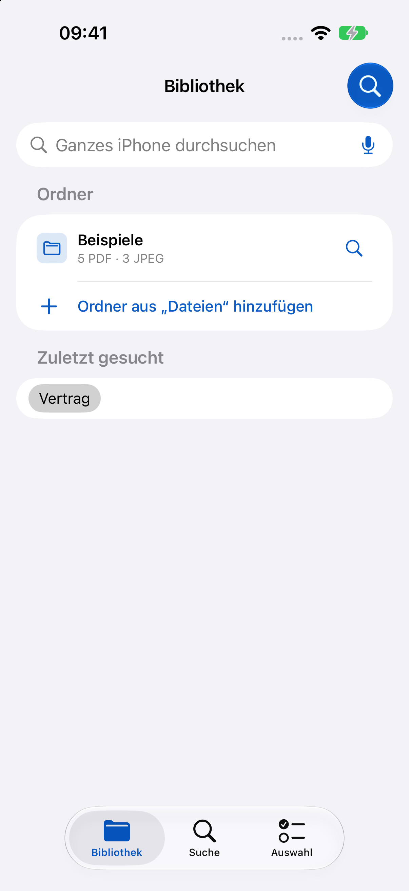
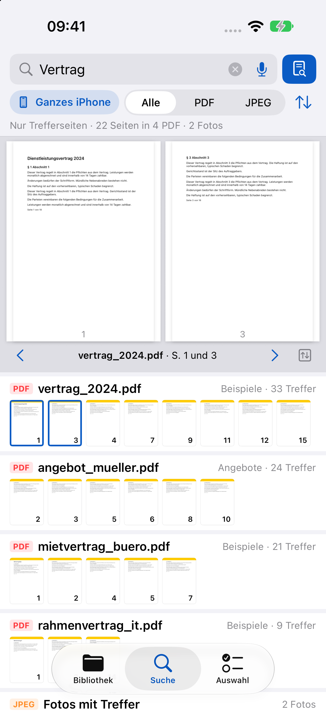
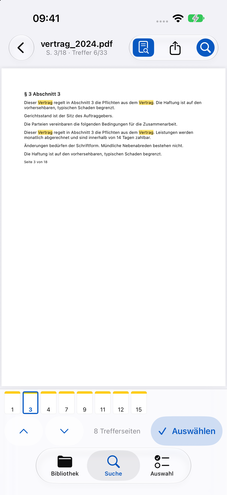
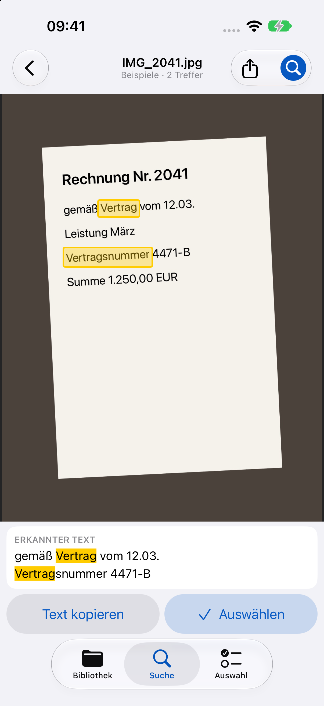
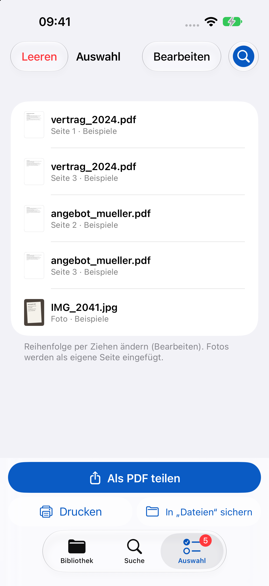

# PDF Search (iPhone)

Eigenständige iPhone-App zum Durchsuchen von PDFs und JPEG-Fotos. Unabhängig von der Mac-App
PDFSucher und einer späteren iPad-App: kein gemeinsamer Code, eigenes Xcode-Projekt, eigener Kern.

Umfang dieser ersten Version (bewusst ohne Word und PowerPoint):

- **Start:** Die App öffnet die Suche, die bei leerem Suchfeld sofort alle Dateien zeigt.
  Kein Titel und kein Suchknopf oben; unten eine flache Leiste (Bibliothek, Suche, Auswahl),
  die in Seiten- und Fotoansicht verschwindet.
- **Bibliothek:** Ordner aus der Dateien-App wählen (iCloud Drive, „Auf meinem iPhone“, OneDrive …).
  Der Zugriff bleibt über Lesezeichen (Security-Scoped Bookmarks) erhalten. Unterordner bis 10 Ebenen.
  Ordner per X aus der Suche nehmen (mit „Rückgängig“), zuletzt gesuchte Begriffe einzeln oder alle löschen.
- **Index:** SQLite mit FTS5/Trigram im App-Container. Findet Wortteile, ohne Rücksicht auf Groß-/Kleinschreibung
  und Akzente. Geänderte Dateien werden beim nächsten Öffnen der App neu gelesen, unveränderte übersprungen.
- **Texterkennung:** JPEG-Fotos und gescannte PDF-Seiten werden auf dem Gerät mit Vision gelesen.
- **Suche:** Suchfeld mit Mikrofon (Spracheingabe, Deutsch), Bereich „Ganzes iPhone“ oder ein Ordner,
  Filter Alle/PDF/JPEG, Sortierung, Umschalter „nur Trefferseiten / alle Seiten“.
  Solange das Suchfeld leer ist, stehen dort alle Dateien untereinander (mit Bereich, Filter und Sortierung).
- **Treffer:** Doppelseiten-Vorschau (oben oder unten, seitlich wischen zum Blättern), eine Kachelreihe pro PDF,
  Raster für Fotos.
- **Seite:** PDF-Seite mit markierten Treffern, Sprung von Treffer zu Treffer, Seitenleiste.
- **Foto:** Fundstellen im Foto umrandet, erkannter Text darunter.
- **Auswahl:** Seiten und Fotos sammeln, Reihenfolge ändern, als ein PDF teilen, drucken oder in „Dateien“ sichern.

## Aufbau

```
iOS/PDFSearch/
 ├─ project.yml        XcodeGen-Projekt (App-Ziel PDFSearch, iOS 26, nur iPhone)
 ├─ App/               SwiftUI-Oberfläche, Spracheingabe, Vorschaubilder
 ├─ Core/              Swift-Paket PDFSearchCore: Index, Ordner-Scan, Textauslesen, Suche, PDF-Ausgabe
 │   └─ Tests/         Tests des Kerns (laufen auf dem Mac, kein Simulator nötig)
 └─ scripts/           build.sh, test.sh, run-simulator.sh
```

## Bauen und testen

Benötigt Xcode 26 mit iOS-Plattform und [XcodeGen](https://github.com/yonaskolb/XcodeGen).

```bash
cd iOS/PDFSearch
scripts/test.sh            # Tests des Kerns
scripts/build.sh           # App für den iOS-Simulator bauen
scripts/run-simulator.sh   # im Simulator starten
scripts/screenshots.sh "iPhone 18 Pro"   # alle Bildschirme mit Beispieldateien fotografieren
```

Debug-Builds kennen Startargumente für Beispieldaten: `-demoData YES -demoQuery Vertrag -demoScreen search`
(`library`, `search`, `page`, `photo`, `selection`). Die Beispieldateien landen im Dokumente-Ordner der App,
der in „Dateien“ unter „Auf meinem iPhone > PDF Search“ erscheint.

| Bibliothek | Alle Dateien | Suche | Seite | Foto | Auswahl |
|---|---|---|---|---|---|
|  |  |  |  |  |  |

Auf ein echtes iPhone kommt die App über Xcode mit einer Apple-ID (Signing & Capabilities > Team);
mit einer kostenlosen Apple-ID läuft sie dann 7 Tage, mit einem Entwickler-Account über TestFlight.

## Bekannte Grenzen

- Indiziert wird nur, solange die App offen ist (iOS beendet Hintergrundarbeit). Große Ordner beim ersten Mal
  am besten mit offener App und Ladekabel indizieren.
- Dateien, die nur in der Cloud liegen, werden erst nach „Laden“ durchsucht.
- Fotos im HEIC-Format (Standard der iPhone-Kamera) sind noch nicht dabei, nur JPEG.
